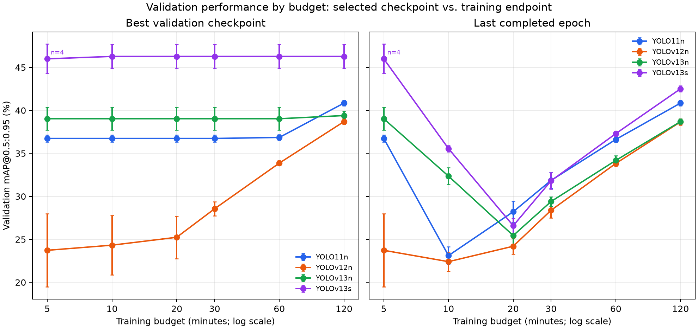

## Material Passport

- Origin Skill: experiment-agent
- Origin Mode: run
- Origin Date: 2026-10-12T19:03:41.381391+00:00
- Verification Status: UNVERIFIED (multi-seed run completed; independent full rerun not performed)
- Version Label: exp_result_v1

## Experiment Result

- **ID**: fullscale-20261011
- **Type**: training
- **Status**: completed
- **Command**: `.venv\Scripts\python.exe run_fullscale_multiseed.py`; `.venv\Scripts\python.exe benchmark_fullscale_latency.py --all`; `.venv\Scripts\python.exe generate_fullscale_report.py`
- **Working Directory**: `E:\HUTECH\NCKH-new\Physical-Visual-DoS-EdgeAI-main\project_yolov13`
- **Duration**: 147765 seconds from first training start through final latency benchmark
- **Exit Code**: 0

### Output Files

| File | Size |
|------|------:|
| `results/BaoCao_TrienKhaiRong_YOLOv13.md` | 33,011 bytes |
| `results/BaoCao_TrienKhaiRong_YOLOv13.docx` | 218,870 bytes |
| `results/fullscale_mAP_growth.png` | 177,025 bytes |
| `results/fullscale_experiments/latency_records.json` | 19,838 bytes |
| `results/fullscale_experiments/epoch_history/ (20 CSVs)` | 99,983 bytes |

### Output Summary

Four models, five seeds each, six time budgets; validation-selected sweet spots: YOLO11n 120m, YOLOv12n 120m, YOLOv13n 5m, YOLOv13s 10m. Per-epoch training histories are archived with SHA-256 checksums.

### Anomalies Detected

223 source AdvT-shirt boxes exceeded image bounds (max overrun 5e-07 normalized); 584 rows were re-encoded with edge headroom; final audit issues=0. No completed epoch within budget for: YOLOv13s seed 2026 at 5m. These milestones are excluded from sweet-spot selection.

# Báo cáo thực nghiệm quy mô lớn: hội tụ thời gian và hiệu quả triển khai YOLOv13

**Ngày lập:** 13-10-2026  
**Thiết bị huấn luyện:** NVIDIA GeForce RTX 5060 (7.96 GiB VRAM); **CPU:** Intel64 Family 6 Model 183 Stepping 1, GenuineIntel; **RAM:** 31.79 GiB  
**Môi trường:** `.venv`; Python 3.14.7; PyTorch 2.11.0+cu128; Ultralytics 8.3.63  
**Thiết kế:** 4 mô hình × 5 seed × tối đa 120 phút; các mốc 5, 10, 20, 30, 60 và 120 phút.

## Tóm tắt

Nghiên cứu đánh giá YOLO11n, YOLOv12n, YOLOv13n và YOLOv13s trên bài toán phát hiện một lớp `person`, dùng 10.000 ảnh COCO 2017 được lấy mẫu xác định cùng toàn bộ 1.123 ảnh AdvT-shirt-1K có trong bản dữ liệu cục bộ. Cùng một split 70/15/15 được giữ cố định; năm seed độc lập được dùng cho mỗi mô hình. Tại từng mốc, checkpoint được chọn chỉ bằng validation mAP@0.5:0.95 rồi đo một lần trên test. Sweet spot được định nghĩa trước là mốc sớm nhất có trung bình validation mAP không cách peak quan sát quá 0.5 điểm phần trăm.

Theo tiêu chí đó, các sweet spot quan sát được là:

- **YOLO11n:** sweet spot 120 phút; peak quan sát ở 120 phút; validation mAP@0.5:0.95 trung bình 40.85% (95% CI [40.53, 41.17]%), cách peak 0.00 điểm phần trăm.
- **YOLOv12n:** sweet spot 120 phút; peak quan sát ở 120 phút; validation mAP@0.5:0.95 trung bình 38.70% (95% CI [38.35, 39.05]%), cách peak 0.00 điểm phần trăm.
- **YOLOv13n:** sweet spot 5 phút; peak quan sát ở 120 phút; validation mAP@0.5:0.95 trung bình 39.03% (95% CI [37.70, 40.36]%), cách peak 0.37 điểm phần trăm.
- **YOLOv13s:** sweet spot 10 phút; peak quan sát ở 10 phút; validation mAP@0.5:0.95 trung bình 46.27% (95% CI [44.88, 47.67]%), cách peak 0.00 điểm phần trăm.

Ở sweet spot theo validation, **YOLOv13s** đạt trung bình test mAP@0.5:0.95 cao nhất trong nhóm này (47.97%). Kết luận chỉ áp dụng cho tập một lớp, cách lấy mẫu, cấu hình và GPU nêu trong báo cáo; nó không khẳng định ưu thế phổ quát của một phiên bản YOLO.

## 1. Thiết lập thực nghiệm

### Dữ liệu và nhãn

- COCO 2017 train/val ([nguồn chính thức](https://cocodataset.org/dataset/detection-2017.htm)) được gộp nguồn rồi lấy mẫu xác định gồm 8.000 ảnh có ít nhất một hộp người không crowd và 2.000 ảnh không có bất kỳ chú thích người nào; ảnh crowd-only bị loại khỏi hai nhóm. Chỉ category `person` được giữ.
- Bản AdvT-shirt-1K ([trang dự án](https://github.com/Wwangb/AdvT-shirt-1K), [dataset mirror](https://huggingface.co/datasets/xingjunm/AdvT-shirt)) cục bộ có 1.123 ảnh, ít hơn 8 ảnh so với 1.131 ảnh nêu trên trang dự án. Hộp người được ánh xạ sang class `person`; nhãn patch vẫn được giữ ở thư mục nguồn và không gộp vào target person.
- 223 hộp người AdvT-shirt trong nhãn nguồn vượt biên tối đa 5e-07 tọa độ chuẩn hóa; 584 dòng được tái mã hóa với đệm 1e-5 để bảo đảm hộp nằm trong ảnh. Kiểm toán cuối cùng ghi nhận 0 dòng nhãn lỗi; tệp thiếu/thừa: 0.
- Tổng cộng 11,123 ảnh; chia cố định theo seed 2026: train 7786 ảnh, val 1669 ảnh, test 1668 ảnh. Dữ liệu dẫn xuất và ảnh COCO chỉ được giữ cục bộ trong `project_yolov13/`.
- Kiểm tra SHA-256 trên 11,123 ảnh phát hiện 0 nhóm ảnh trùng byte giữa các split; số nhóm trùng COCO image ID giữa split là 0. Kiểm tra này không loại trừ khung hình gần giống hoặc cùng người/cảnh xuất hiện ở nhiều split.
- COCO annotations được phân phối riêng với license ảnh Flickr; do đó ảnh và dữ liệu thô không được đưa lên GitHub. Bản mirror AdvT-shirt khai báo Apache-2.0 trên dataset card; cần kiểm tra điều khoản nguồn trước khi tái phân phối.

### Mô hình và điều kiện huấn luyện

Mỗi seed bắt đầu từ trọng số pretrained tương ứng: [YOLO11](https://docs.ultralytics.com/models/yolo11/), [YOLOv12](https://github.com/sunsmarterjie/yolov12), [YOLOv13](https://github.com/iMoonLab/yolov13). Dùng ảnh 416 px, batch 8, SGD (lr0=0.01, lrf=0.01, momentum=0.937, weight decay=0.0005), AMP, deterministic mode, 0 dataloader workers và cùng augmentation cho mọi mô hình (mosaic=1, HSV 0.015/0.7/0.4, translate=0.1, scale=0.5, fliplr=0.5; mixup=0). Huấn luyện tiếp tục theo epoch cho đến khi vượt ngân sách 120 phút rồi dừng ở ranh giới epoch đã lưu. Mỗi epoch có checkpoint. Mốc thời gian lấy từ thời gian huấn luyện tích lũy trong `results.csv`; ở mỗi mốc, checkpoint có validation mAP@0.5:0.95 cao nhất trong các epoch đã hoàn tất được chọn. Không có epoch nào trước ngân sách thì mốc được đánh dấu thiếu dữ liệu.

Tổng thời gian tích lũy trong CSV của 20 quỹ đạo là 40.54 giờ; mỗi lượt thực chạy 120.20–123.28 phút, vượt cap tối đa 3.28 phút do ranh giới epoch. Timer này bao gồm train, validation và lưu checkpoint trong vòng lặp epoch; các phép đánh giá test sau huấn luyện và benchmark latency được thực hiện riêng. Epoch vượt ngân sách không được dùng cho mốc 120 phút.

Các mô hình YOLOv12 và YOLOv13 được nạp từ mã nguồn tương ứng đã lưu trong thư mục dự án; YOLO11 dùng Ultralytics cục bộ. Máy: GPU NVIDIA GeForce RTX 5060 (7.96 GiB), CPU Intel64 Family 6 Model 183 Stepping 1, GenuineIntel, RAM 31.79 GiB; Python 3.14.7, PyTorch 2.11.0+cu128, CUDA có sẵn. Giá trị CPU/RAM dựa trên máy chạy thí nghiệm.

Log của YOLOv12/YOLOv13 ghi nhận không có gói `flash_attn` và chuyển sang `torch.nn.functional.scaled_dot_product_attention`. Benchmark phản ánh implementation SDPA trong môi trường này; không dùng tốc độ công bố với một backend khác để thay thế kết quả thực đo.

CSV theo epoch của từng seed được lưu cùng checksum SHA-256 dưới `results/fullscale_experiments/epoch_history/`; checkpoint đầy đủ được giữ trong thư mục `runs/train/` của dự án.

Danh sách phiên bản dependency, commit nguồn nếu có, SHA-256 của 324 tệp Python thuộc hai implementation, bốn trọng số pretrained và manifest dữ liệu được lưu trong `results/fullscale_setup/dependency_versions.txt` và `provenance.json`. Các dấu vết này định danh môi trường đã chạy; nghiên cứu chưa thực hiện một lượt tái lập độc lập hoàn chỉnh.

### Chỉ số và thống kê

Precision, recall, mAP@0.5 và mAP@0.5:0.95 đo trên test tại checkpoint validation-selected. Test được giữ khỏi fine-tuning và chọn checkpoint; tính độc lập với pretraining không được bảo đảm.

Latency đo riêng với batch 1, 416 px, FP32 (`half=False`), bỏ 32 frame warm-up rồi lấy median thời gian tiền xử lý + inference + hậu xử lý do Ultralytics ghi nhận trên tối đa 500 ảnh test cố định; FPS = 1000 / latency median. Đây là tốc độ pipeline xử lý ảnh, không bao gồm đọc/giải mã ảnh, camera, truyền mạng hoặc toàn bộ độ trễ ứng dụng.

Parameters là tổng `numel` của tham số checkpoint chia 10⁶. FLOPs là ước tính từ `get_flops`: THOP MACs nhân 2, thường profiling ở kích thước stride rồi quy đổi theo diện tích đến 416 px; nếu nhánh đó lỗi, hàm thử trực tiếp ở 416 px. Quy tắc đếm của profiler và phép quy đổi có thể không bao phủ mọi phép toán functional/custom hoặc độ phức tạp theo kích thước của attention. Vì vậy FLOPs được dùng như ước tính tham khảo; tốc độ triển khai dựa trên latency thực đo, và không so trực tiếp với FLOPs công bố ở 640 px.

Các giá trị đa seed trình bày μ ± σ mẫu; khoảng tin cậy 95% dùng phân phối t Student với df=n−1 (n=5, df=4 tại sweet spot). Mốc có seed chưa hoàn tất epoch dùng số seed thực có trong bảng và không được chọn làm sweet spot nếu n<5. CI chưa hiệu chỉnh cho việc chọn mốc trên cùng validation. Dung sai 0.5 điểm phần trăm được áp dụng cho trung bình điểm, không phải kiểm định tương đương thống kê.

## 2. Bảng so sánh đa seed tại sweet spot

Mốc sweet spot được chọn theo validation; các chỉ số kiểm tra bên dưới dùng test holdout đối với fine-tuning. Ô metric ghi μ ± σ và 95% CI của trung bình.

| Model | Params (M) | FLOPs (G) | Precision (%) | Recall (%) | mAP@0.5 (%) | mAP@0.5:0.95 (%) | Latency (ms/frame) | FPS |
|---|---|---|---|---|---|---|---|---|
| YOLO11n | 2.590 ± 0.000; 95% CI [2.590, 2.590] | 2.72 ± 0.00; 95% CI [2.72, 2.72] | 77.10 ± 0.35; 95% CI [76.66, 77.54] | 55.98 ± 0.57; 95% CI [55.28, 56.69] | 65.07 ± 0.29; 95% CI [64.71, 65.44] | 42.44 ± 0.22; 95% CI [42.17, 42.72] | 2.58 ± 0.42 ms; 95% CI [2.06, 3.11] | 393.85 ± 53.32; 95% CI [327.65, 460.05] |
| YOLOv12n | 2.550 ± 0.000; 95% CI [2.550, 2.550] | 2.73 ± 0.00; 95% CI [2.73, 2.73] | 75.32 ± 1.38; 95% CI [73.61, 77.04] | 54.25 ± 0.36; 95% CI [53.80, 54.69] | 62.92 ± 0.27; 95% CI [62.58, 63.26] | 40.49 ± 0.31; 95% CI [40.10, 40.87] | 2.77 ± 0.07 ms; 95% CI [2.68, 2.86] | 360.93 ± 9.33; 95% CI [349.34, 372.51] |
| YOLOv13n | 2.460 ± 0.000; 95% CI [2.460, 2.460] | 2.69 ± 0.00; 95% CI [2.69, 2.69] | 76.43 ± 2.37; 95% CI [73.49, 79.36] | 54.35 ± 0.87; 95% CI [53.27, 55.43] | 63.19 ± 0.72; 95% CI [62.30, 64.09] | 40.80 ± 0.97; 95% CI [39.59, 42.00] | 4.16 ± 0.21 ms; 95% CI [3.91, 4.42] | 240.68 ± 11.42; 95% CI [226.51, 254.85] |
| YOLOv13s | 9.553 ± 0.000; 95% CI [9.553, 9.553] | 9.15 ± 0.00; 95% CI [9.15, 9.15] | 80.46 ± 1.44; 95% CI [78.68, 82.25] | 61.08 ± 1.22; 95% CI [59.56, 62.59] | 70.94 ± 1.06; 95% CI [69.63, 72.26] | 47.97 ± 1.13; 95% CI [46.57, 49.37] | 51.79 ± 2.08 ms; 95% CI [49.20, 54.37] | 19.33 ± 0.74; 95% CI [18.41, 20.26] |

## 3. Hội tụ theo thời gian và điểm tối ưu

Bảng và Hình 1 tách hai câu hỏi: checkpoint validation tốt nhất đã có thể chọn trong ngân sách (best-so-far) và hiệu năng validation của epoch cuối cùng thực sự hoàn tất trước ngân sách. Best-so-far có thể lặp lại giữa nhiều mốc, nhất là khi trọng số khởi tạo đã mạnh; đường epoch cuối cho thấy tác động của quá trình fine-tuning. Δ và lợi ích biên trong bảng tính theo best-so-far chỉ khi cả hai mốc liền trước và hiện tại có đủ cùng năm seed; ô còn lại ghi thiếu dữ liệu để tránh so sánh các nhóm seed khác nhau. Loss lấy tại epoch cuối. Mỗi epoch có thời gian riêng nên mốc là giới hạn tối đa, không nhất thiết khớp đúng thời lượng.

| Model | Budget (min) | n | Best-checkpoint val mAP95 (%) μ±σ; 95% CI | Last-epoch val mAP95 (%) μ±σ; 95% CI | Δ best from previous (pp) | Best-checkpoint gain (pp/min) | Train loss (sum) | Val loss (sum) |
|---|---|---|---|---|---|---|---|---|
| YOLO11n | 5 | 5 | 36.74 ± 0.33; 95% CI [36.32, 37.15] | 36.74 ± 0.33; 95% CI [36.32, 37.15] | — | — | 4.16 | 3.64 |
| YOLO11n | 10 | 5 | 36.74 ± 0.33; 95% CI [36.32, 37.15] | 23.11 ± 0.82; 95% CI [22.09, 24.14] | 0.00 | 0.00 | 4.45 | 4.64 |
| YOLO11n | 20 | 5 | 36.74 ± 0.33; 95% CI [36.32, 37.15] | 28.21 ± 1.00; 95% CI [26.98, 29.45] | 0.00 | 0.00 | 4.37 | 4.21 |
| YOLO11n | 30 | 5 | 36.74 ± 0.33; 95% CI [36.32, 37.15] | 31.86 ± 0.74; 95% CI [30.94, 32.78] | 0.00 | 0.00 | 4.13 | 3.94 |
| YOLO11n | 60 | 5 | 36.85 ± 0.25; 95% CI [36.53, 37.17] | 36.62 ± 0.27; 95% CI [36.29, 36.95] | 0.11 | 0.00 | 3.82 | 3.58 |
| **YOLO11n** | **120** | 5 | 40.85 ± 0.26; 95% CI [40.53, 41.17] | 40.85 ± 0.26; 95% CI [40.53, 41.17] | 4.00 | 0.07 | 3.56 | 3.30 |
| YOLOv12n | 5 | 5 | 23.73 ± 3.43; 95% CI [19.46, 27.99] | 23.73 ± 3.43; 95% CI [19.46, 27.99] | — | — | 4.78 | 4.57 |
| YOLOv12n | 10 | 5 | 24.32 ± 2.79; 95% CI [20.86, 27.79] | 22.41 ± 0.92; 95% CI [21.27, 23.54] | 0.60 | 0.12 | 4.57 | 4.71 |
| YOLOv12n | 20 | 5 | 25.24 ± 1.99; 95% CI [22.77, 27.72] | 24.20 ± 0.75; 95% CI [23.27, 25.13] | 0.92 | 0.09 | 4.69 | 4.60 |
| YOLOv12n | 30 | 5 | 28.55 ± 0.67; 95% CI [27.72, 29.39] | 28.38 ± 0.72; 95% CI [27.50, 29.27] | 3.31 | 0.33 | 4.39 | 4.26 |
| YOLOv12n | 60 | 5 | 33.87 ± 0.23; 95% CI [33.58, 34.15] | 33.83 ± 0.29; 95% CI [33.47, 34.19] | 5.31 | 0.18 | 4.00 | 3.81 |
| **YOLOv12n** | **120** | 5 | 38.70 ± 0.28; 95% CI [38.35, 39.05] | 38.66 ± 0.29; 95% CI [38.30, 39.03] | 4.83 | 0.08 | 3.71 | 3.46 |
| **YOLOv13n** | **5** | 5 | 39.03 ± 1.07; 95% CI [37.70, 40.36] | 39.03 ± 1.07; 95% CI [37.70, 40.36] | — | — | 3.96 | 3.55 |
| YOLOv13n | 10 | 5 | 39.03 ± 1.07; 95% CI [37.70, 40.36] | 32.35 ± 0.79; 95% CI [31.37, 33.34] | 0.00 | 0.00 | 3.92 | 3.98 |
| YOLOv13n | 20 | 5 | 39.03 ± 1.07; 95% CI [37.70, 40.36] | 25.44 ± 0.87; 95% CI [24.37, 26.52] | 0.00 | 0.00 | 4.59 | 4.52 |
| YOLOv13n | 30 | 5 | 39.03 ± 1.07; 95% CI [37.70, 40.36] | 29.40 ± 0.45; 95% CI [28.84, 29.96] | 0.00 | 0.00 | 4.33 | 4.21 |
| YOLOv13n | 60 | 5 | 39.03 ± 1.07; 95% CI [37.70, 40.36] | 34.18 ± 0.45; 95% CI [33.62, 34.74] | 0.00 | 0.00 | 3.98 | 3.80 |
| YOLOv13n | 120 | 5 | 39.40 ± 0.42; 95% CI [38.88, 39.92] | 38.70 ± 0.26; 95% CI [38.37, 39.02] | 0.37 | 0.01 | 3.69 | 3.51 |
| YOLOv13s | 5 | 4 | 45.99 ± 1.08; 95% CI [44.27, 47.72] | 45.99 ± 1.08; 95% CI [44.27, 47.72] | — | — | 3.10 | 3.02 |
| **YOLOv13s** | **10** | 5 | 46.27 ± 1.13; 95% CI [44.88, 47.67] | 35.56 ± 0.30; 95% CI [35.19, 35.93] | — | — | 3.53 | 3.67 |
| YOLOv13s | 20 | 5 | 46.27 ± 1.13; 95% CI [44.88, 47.67] | 26.59 ± 0.69; 95% CI [25.73, 27.44] | 0.00 | 0.00 | 4.53 | 4.48 |
| YOLOv13s | 30 | 5 | 46.27 ± 1.13; 95% CI [44.88, 47.67] | 31.81 ± 0.77; 95% CI [30.86, 32.76] | 0.00 | 0.00 | 4.23 | 4.08 |
| YOLOv13s | 60 | 5 | 46.27 ± 1.13; 95% CI [44.88, 47.67] | 37.30 ± 0.25; 95% CI [36.99, 37.61] | 0.00 | 0.00 | 3.83 | 3.68 |
| YOLOv13s | 120 | 5 | 46.27 ± 1.13; 95% CI [44.88, 47.67] | 42.51 ± 0.29; 95% CI [42.15, 42.87] | 0.00 | 0.00 | 3.50 | 3.33 |



### Ma trận sweet spot và bão hòa

- **YOLO11n:** sweet spot 120 phút; peak quan sát ở 120 phút; validation mAP@0.5:0.95 trung bình 40.85% (95% CI [40.53, 41.17]%), cách peak 0.00 điểm phần trăm.
- **YOLOv12n:** sweet spot 120 phút; peak quan sát ở 120 phút; validation mAP@0.5:0.95 trung bình 38.70% (95% CI [38.35, 39.05]%), cách peak 0.00 điểm phần trăm.
- **YOLOv13n:** sweet spot 5 phút; peak quan sát ở 120 phút; validation mAP@0.5:0.95 trung bình 39.03% (95% CI [37.70, 40.36]%), cách peak 0.37 điểm phần trăm.
- **YOLOv13s:** sweet spot 10 phút; peak quan sát ở 10 phút; validation mAP@0.5:0.95 trung bình 46.27% (95% CI [44.88, 47.67]%), cách peak 0.00 điểm phần trăm.

Theo định nghĩa dung sai, sweet spot là điểm vận hành sớm nhất gần trần validation trong cửa sổ 120 phút. Peak trung bình có thể xuất hiện muộn hơn; phần cải thiện bổ sung sau sweet spot lần lượt là YOLO11n +0.00 pp; YOLOv12n +0.00 pp; YOLOv13n +0.37 pp; YOLOv13s +0.00 pp. Các metric test ở từng mốc được lưu trong bản ghi JSON của seed; bảng hội tụ trình bày validation và không dùng test để chọn thời gian. Đây là sweet spot của việc chọn checkpoint trong ngân sách, không tự chứng minh rằng epoch cuối đã hội tụ.

## 4. Thảo luận

### Tăng trưởng và diminishing returns

Xem đường cong trên để đối chiếu tốc độ tăng mAP theo thời gian. Các điểm là trung bình các seed có epoch hợp lệ tại mốc đó; số seed n được ghi trong bảng và điểm n<5 được chú thích trên hình. Thanh sai số là CI 95% t với df=n−1. Tiêu chí 0.5 điểm phần trăm cung cấp một quy tắc rõ ràng để cân bằng độ chính xác với thời gian; nó không thay thế đánh giá chi phí năng lượng hoặc giá trị triển khai.

YOLO11n chọn epoch 1 ở 0/5 seed tại sweet spot; thời gian checkpoint thực được chọn nằm trong 117.99–119.61 phút; YOLOv12n chọn epoch 1 ở 0/5 seed tại sweet spot; thời gian checkpoint thực được chọn nằm trong 112.77–118.73 phút; YOLOv13n chọn epoch 1 ở 5/5 seed tại sweet spot; thời gian checkpoint thực được chọn nằm trong 4.32–4.38 phút; YOLOv13s chọn epoch 1 ở 5/5 seed tại sweet spot; thời gian checkpoint thực được chọn nằm trong 4.48–5.63 phút. Khi checkpoint sớm tiếp tục được chọn ở mốc dài, đường best-so-far phẳng chỉ cho thấy fine-tuning chưa vượt checkpoint đó. Cần đối chiếu đường epoch cuối để nhận biết giảm hiệu năng rồi phục hồi; không diễn giải riêng đường best-so-far thành hội tụ ổn định.

### So sánh YOLOv13 với baseline

YOLOv13n và YOLOv13s đạt sweet spot lần lượt ở 5 và 10 phút. YOLO11n và YOLOv12n đạt ở 120 và 120 phút. Theo test mAP@0.5:0.95 tại checkpoint sweet spot, mô hình cao nhất là YOLOv13s (47.97% trung bình); phải so sánh CI và độ lệch seed trước khi kết luận khác biệt có ý nghĩa. Thí nghiệm này không khẳng định YOLOv13 luôn vượt baseline; lựa chọn mô hình cần cân nhắc đồng thời latency, kích thước và hiệu năng.

YOLO11n có SD test mAP95 0.22 điểm phần trăm; YOLOv12n có SD test mAP95 0.31 điểm phần trăm; YOLOv13n có SD test mAP95 0.97 điểm phần trăm; YOLOv13s có SD test mAP95 1.13 điểm phần trăm. Chênh lệch ghép theo seed dưới đây mang tính mô tả, chưa hiệu chỉnh đa so sánh hoặc độ bất định do chọn mốc; ngân sách của từng model có thể khác nhau:

- YOLOv13n − YOLO11n tại sweet spot riêng: Δ test mAP95 -1.65 ± 1.01; 95% CI [-2.90, -0.40] điểm phần trăm; latency trung bình 4.16 so với 2.58 ms/frame.
- YOLOv13n − YOLOv12n tại sweet spot riêng: Δ test mAP95 0.31 ± 1.14; 95% CI [-1.11, 1.72] điểm phần trăm; latency trung bình 4.16 so với 2.77 ms/frame.
- YOLOv13s − YOLO11n tại sweet spot riêng: Δ test mAP95 5.53 ± 1.22; 95% CI [4.01, 7.04] điểm phần trăm; latency trung bình 51.79 so với 2.58 ms/frame.
- YOLOv13s − YOLOv12n tại sweet spot riêng: Δ test mAP95 7.48 ± 1.07; 95% CI [6.15, 8.82] điểm phần trăm; latency trung bình 51.79 so với 2.77 ms/frame.

### Hội tụ, overfitting và giới hạn

Loss và mAP epoch cuối lấy từ epoch hoàn tất cuối cùng trong ngân sách; mAP best-so-far lấy từ checkpoint có validation tốt nhất trong toàn bộ thời gian đã chạy đến mốc đó. Hai chuỗi mô tả hai góc nhìn khác nhau và được đặt cạnh nhau ở bảng cùng biểu đồ. Bảng dưới đếm seed có mAP epoch cuối còn tăng hơn 0.5 điểm trong 60→120 phút và seed có dấu hiệu overfit ứng viên (train loss giảm ≥5%, val loss tăng ≥5%, còn mAP epoch cuối từ 5→120 phút tăng không quá 0.5 điểm). Chỉ ghép các seed đủ mốc 5, 60 và 120 phút. Đây là chỉ báo mô tả, không phải kiểm định thống kê; không kết luận underfitting chỉ từ loss còn cao.

| Model | Paired seeds | Δ train loss (5→120m) | Δ val loss (5→120m) | Δ endpoint val mAP95 (60→120m, pp) | Seeds still gaining >0.5 pp | Overfit candidate seeds |
|---|---:|---:|---:|---:|---:|---:|
| YOLO11n | 5 | -0.60 | -0.35 | 4.23 | 5 | 0 |
| YOLOv12n | 5 | -1.07 | -1.11 | 4.84 | 5 | 0 |
| YOLOv13n | 5 | -0.27 | -0.05 | 4.52 | 5 | 0 |
| YOLOv13s | 4 | 0.40 | 0.31 | 5.26 | 4 | 0 |

Năm seed đo biến thiên ngẫu nhiên của huấn luyện trên một split cố định, không đo độ bất định do cách chia dữ liệu.

**Internal validity:** 1,429 ảnh test bắt nguồn từ COCO train2017, có nguy cơ đã xuất hiện trong pretraining; vì vậy holdout chỉ độc lập với fine-tuning. Dữ liệu được chia theo ảnh trong từng stratum, chưa chứng minh tách biệt người hoặc chuỗi video AdvT-shirt. Cùng hyperparameters chưa chắc tối ưu cho mỗi kiến trúc; pretrained khác nhau, tốc độ epoch khác nhau và chọn checkpoint trên validation cùng ảnh hưởng so sánh. Không suy ra lợi ích kiến trúc thuần túy từ benchmark này.

**External validity:** COCO chỉ là mẫu 10.000 ảnh, không phải toàn bộ benchmark gốc; bản AdvT-shirt mirror thiếu 8 ảnh so với trang dự án. Target chỉ gồm person, không đo phát hiện patch hay khả năng chống tấn công. Một split cố định và năm seed chưa đủ bảo đảm triển khai rộng; cần test ngoài miền và tách theo người/chuỗi, đồng thời loại trừ ảnh đã dùng để pretrain khi đánh giá khả năng tổng quát hóa.

**Hardware validity:** RTX 5060 không đại diện cho thiết bị edge đích. Latency đo một lượt cho mỗi seed theo thứ tự cố định, chịu ảnh hưởng của nhiệt độ, xung GPU, driver, CUDA và pipeline; CI qua năm checkpoint không thay thế phép đo lặp có thứ tự ngẫu nhiên. FPS nghịch đảo median không phải throughput camera hay throughput xử lý đồng thời. Không đo năng lượng; cần benchmark lại đúng thiết bị, định dạng model và pipeline ứng dụng cuối.

## 5. Khuyến nghị triển khai và kết luận

Khi ưu tiên độ chính xác trong nhóm đã đo, chọn YOLOv13s với ngân sách 10 phút: test mAP95 47.97%, latency pipeline trung bình 51.79 ms/frame ở FP32 batch 1. Đối chiếu mức latency này với yêu cầu tốc độ trước khi triển khai; định dạng FP16, ONNX hoặc TensorRT chưa được benchmark trong nghiên cứu này.

Nếu lấy mục tiêu 30 FPS làm ví dụ minh họa (ngân sách pipeline 33.33 ms/frame), YOLO11n có test mAP95 trung bình cao nhất trong các model có latency trung bình dưới ngưỡng: 42.44% tại 120 phút, latency 2.58 ms/frame. Đây là sàng lọc theo trung bình trên RTX 5060, chưa bảo đảm deadline từng frame hoặc 30 FPS của toàn ứng dụng; cần đo tail latency, decode và thiết bị đích.

Khuyến nghị chọn ngân sách huấn luyện theo sweet spot đã đo cho đúng model, dữ liệu và mục tiêu triển khai; dùng seed bổ sung và split ngoài miền trước khi khóa lựa chọn production. Nếu ngân sách cho phép, giữ đánh giá ở 120 phút như một kiểm tra trần hiệu năng; dừng sớm ở sweet spot khi lợi ích thêm thấp hơn ngưỡng 0.5 điểm phần trăm. Trước khi triển khai edge, đo lại latency trên thiết bị đích, batch/decode pipeline thực và định dạng xuất cuối.

YOLO11n, YOLOv12n có sweet spot tại biên 120 phút; kết quả đó chưa chứng minh bão hòa và cần chạy dài hơn để tìm trần ngoài cửa sổ quan sát. Với model liên tục chọn checkpoint rất sớm, cần đo thêm trọng số pretrained ở mốc 0 phút và điều chỉnh learning rate/warm-up để xác định fine-tuning có đem lại lợi ích. Sweet spot pilot và nghiên cứu mở rộng không thể dùng thay nhau khi kích thước dữ liệu, tốc độ epoch và cách chọn checkpoint thay đổi.

Nghiên cứu cung cấp pipeline tái lập cho dữ liệu person-detection đã hợp nhất, bốn mô hình, năm seed, sáu ngân sách thời gian, test holdout, profiling batch 1, và quy tắc sweet spot định trước. Kết luận về mô hình tốt nhất chỉ rút ra từ kết quả thực đo trong bảng, với giới hạn được nêu rõ.

## Tài liệu tham khảo và dữ liệu

1. COCO 2017 Detection: <https://cocodataset.org/dataset/detection-2017.htm>.
2. AdvT-shirt-1K source project: <https://github.com/Wwangb/AdvT-shirt-1K>; dataset card mirror: <https://huggingface.co/datasets/xingjunm/AdvT-shirt>.
3. M. Lei et al., “YOLOv13: Real-Time Object Detection with Hypergraph-Enhanced Adaptive Visual Perception,” arXiv:2506.17733, 2025. <https://arxiv.org/abs/2506.17733>; official repository: <https://github.com/iMoonLab/yolov13>.
4. YOLOv12 official repository: <https://github.com/sunsmarterjie/yolov12>.
5. YOLO11 official Ultralytics documentation: <https://docs.ultralytics.com/models/yolo11/>.

## Mã LaTeX IEEE cho các bảng

### Bảng 1

```latex
% IEEE-style comparison table (compile in a document using IEEEtran)
% Preamble dependency: booktabs package for top/mid/bottom rules.
\begin{table*}[t]
\centering
\caption{Multi-seed test performance and batch-1 latency at the validation-selected sweet spot. Values are mean $\pm$ SD with 95\% t confidence intervals.}
\label{tab:sweetspot}
\scriptsize
\setlength{\tabcolsep}{2pt}
\begin{tabular}{lrrrrrrrr}
\toprule
Model & Params (M) & FLOPs (G) & Precision (\%) & Recall (\%) & mAP@0.5 (\%) & mAP@0.5:0.95 (\%) & Latency (ms) & FPS \\
\midrule
YOLO11n & 2.590 & 2.72 & \shortstack{$77.1 \pm 0.4$\\CI [76.7, 77.5]} & \shortstack{$56.0 \pm 0.6$\\CI [55.3, 56.7]} & \shortstack{$65.1 \pm 0.3$\\CI [64.7, 65.4]} & \shortstack{$42.4 \pm 0.2$\\CI [42.2, 42.7]} & \shortstack{$2.6 \pm 0.4$\\CI [2.1, 3.1]} & \shortstack{$393.9 \pm 53.3$\\CI [327.7, 460.0]} \\
YOLOv12n & 2.550 & 2.73 & \shortstack{$75.3 \pm 1.4$\\CI [73.6, 77.0]} & \shortstack{$54.2 \pm 0.4$\\CI [53.8, 54.7]} & \shortstack{$62.9 \pm 0.3$\\CI [62.6, 63.3]} & \shortstack{$40.5 \pm 0.3$\\CI [40.1, 40.9]} & \shortstack{$2.8 \pm 0.1$\\CI [2.7, 2.9]} & \shortstack{$360.9 \pm 9.3$\\CI [349.3, 372.5]} \\
YOLOv13n & 2.460 & 2.69 & \shortstack{$76.4 \pm 2.4$\\CI [73.5, 79.4]} & \shortstack{$54.4 \pm 0.9$\\CI [53.3, 55.4]} & \shortstack{$63.2 \pm 0.7$\\CI [62.3, 64.1]} & \shortstack{$40.8 \pm 1.0$\\CI [39.6, 42.0]} & \shortstack{$4.2 \pm 0.2$\\CI [3.9, 4.4]} & \shortstack{$240.7 \pm 11.4$\\CI [226.5, 254.8]} \\
YOLOv13s & 9.553 & 9.15 & \shortstack{$80.5 \pm 1.4$\\CI [78.7, 82.2]} & \shortstack{$61.1 \pm 1.2$\\CI [59.6, 62.6]} & \shortstack{$70.9 \pm 1.1$\\CI [69.6, 72.3]} & \shortstack{$48.0 \pm 1.1$\\CI [46.6, 49.4]} & \shortstack{$51.8 \pm 2.1$\\CI [49.2, 54.4]} & \shortstack{$19.3 \pm 0.7$\\CI [18.4, 20.3]} \\
\bottomrule
\end{tabular}
\end{table*}
```

### Bảng 2

```latex
% IEEE-style convergence table; a star marks the earliest budget within 0.5 pp of peak mean validation mAP.
% Preamble dependency: booktabs package for top/mid/bottom rules.
\begin{table*}[t]
\centering
\caption{Validation convergence and endpoint loss at each training budget.}
\label{tab:convergence}
\scriptsize
\begin{tabular}{llrrrrrrr}
\toprule
Model & Minutes & $n$ & Best-checkpoint val mAP95 (\%) & Last-epoch val mAP95 (\%) & $\Delta$ best (pp) & Gain (pp/min) & Train loss & Val loss \\
\midrule
YOLO11n & 5 & 5 & \shortstack{$36.7 \pm 0.3$\\CI [36.3, 37.2]} & \shortstack{$36.7 \pm 0.3$\\CI [36.3, 37.2]} & — & — & 4.16 & 3.64 \\
YOLO11n & 10 & 5 & \shortstack{$36.7 \pm 0.3$\\CI [36.3, 37.2]} & \shortstack{$23.1 \pm 0.8$\\CI [22.1, 24.1]} & 0.00 & 0.00 & 4.45 & 4.64 \\
YOLO11n & 20 & 5 & \shortstack{$36.7 \pm 0.3$\\CI [36.3, 37.2]} & \shortstack{$28.2 \pm 1.0$\\CI [27.0, 29.5]} & 0.00 & 0.00 & 4.37 & 4.21 \\
YOLO11n & 30 & 5 & \shortstack{$36.7 \pm 0.3$\\CI [36.3, 37.2]} & \shortstack{$31.9 \pm 0.7$\\CI [30.9, 32.8]} & 0.00 & 0.00 & 4.13 & 3.94 \\
YOLO11n & 60 & 5 & \shortstack{$36.9 \pm 0.3$\\CI [36.5, 37.2]} & \shortstack{$36.6 \pm 0.3$\\CI [36.3, 36.9]} & 0.11 & 0.00 & 3.82 & 3.58 \\
YOLO11n & 120$^\star$ & 5 & \shortstack{$40.8 \pm 0.3$\\CI [40.5, 41.2]} & \shortstack{$40.8 \pm 0.3$\\CI [40.5, 41.2]} & 4.00 & 0.07 & 3.56 & 3.30 \\
YOLOv12n & 5 & 5 & \shortstack{$23.7 \pm 3.4$\\CI [19.5, 28.0]} & \shortstack{$23.7 \pm 3.4$\\CI [19.5, 28.0]} & — & — & 4.78 & 4.57 \\
YOLOv12n & 10 & 5 & \shortstack{$24.3 \pm 2.8$\\CI [20.9, 27.8]} & \shortstack{$22.4 \pm 0.9$\\CI [21.3, 23.5]} & 0.60 & 0.12 & 4.57 & 4.71 \\
YOLOv12n & 20 & 5 & \shortstack{$25.2 \pm 2.0$\\CI [22.8, 27.7]} & \shortstack{$24.2 \pm 0.7$\\CI [23.3, 25.1]} & 0.92 & 0.09 & 4.69 & 4.60 \\
YOLOv12n & 30 & 5 & \shortstack{$28.6 \pm 0.7$\\CI [27.7, 29.4]} & \shortstack{$28.4 \pm 0.7$\\CI [27.5, 29.3]} & 3.31 & 0.33 & 4.39 & 4.26 \\
YOLOv12n & 60 & 5 & \shortstack{$33.9 \pm 0.2$\\CI [33.6, 34.2]} & \shortstack{$33.8 \pm 0.3$\\CI [33.5, 34.2]} & 5.31 & 0.18 & 4.00 & 3.81 \\
YOLOv12n & 120$^\star$ & 5 & \shortstack{$38.7 \pm 0.3$\\CI [38.3, 39.0]} & \shortstack{$38.7 \pm 0.3$\\CI [38.3, 39.0]} & 4.83 & 0.08 & 3.71 & 3.46 \\
YOLOv13n & 5$^\star$ & 5 & \shortstack{$39.0 \pm 1.1$\\CI [37.7, 40.4]} & \shortstack{$39.0 \pm 1.1$\\CI [37.7, 40.4]} & — & — & 3.96 & 3.55 \\
YOLOv13n & 10 & 5 & \shortstack{$39.0 \pm 1.1$\\CI [37.7, 40.4]} & \shortstack{$32.4 \pm 0.8$\\CI [31.4, 33.3]} & 0.00 & 0.00 & 3.92 & 3.98 \\
YOLOv13n & 20 & 5 & \shortstack{$39.0 \pm 1.1$\\CI [37.7, 40.4]} & \shortstack{$25.4 \pm 0.9$\\CI [24.4, 26.5]} & 0.00 & 0.00 & 4.59 & 4.52 \\
YOLOv13n & 30 & 5 & \shortstack{$39.0 \pm 1.1$\\CI [37.7, 40.4]} & \shortstack{$29.4 \pm 0.5$\\CI [28.8, 30.0]} & 0.00 & 0.00 & 4.33 & 4.21 \\
YOLOv13n & 60 & 5 & \shortstack{$39.0 \pm 1.1$\\CI [37.7, 40.4]} & \shortstack{$34.2 \pm 0.4$\\CI [33.6, 34.7]} & 0.00 & 0.00 & 3.98 & 3.80 \\
YOLOv13n & 120 & 5 & \shortstack{$39.4 \pm 0.4$\\CI [38.9, 39.9]} & \shortstack{$38.7 \pm 0.3$\\CI [38.4, 39.0]} & 0.37 & 0.01 & 3.69 & 3.51 \\
YOLOv13s & 5 & 4 & \shortstack{$46.0 \pm 1.1$\\CI [44.3, 47.7]} & \shortstack{$46.0 \pm 1.1$\\CI [44.3, 47.7]} & — & — & 3.10 & 3.02 \\
YOLOv13s & 10$^\star$ & 5 & \shortstack{$46.3 \pm 1.1$\\CI [44.9, 47.7]} & \shortstack{$35.6 \pm 0.3$\\CI [35.2, 35.9]} & — & — & 3.53 & 3.67 \\
YOLOv13s & 20 & 5 & \shortstack{$46.3 \pm 1.1$\\CI [44.9, 47.7]} & \shortstack{$26.6 \pm 0.7$\\CI [25.7, 27.4]} & 0.00 & 0.00 & 4.53 & 4.48 \\
YOLOv13s & 30 & 5 & \shortstack{$46.3 \pm 1.1$\\CI [44.9, 47.7]} & \shortstack{$31.8 \pm 0.8$\\CI [30.9, 32.8]} & 0.00 & 0.00 & 4.23 & 4.08 \\
YOLOv13s & 60 & 5 & \shortstack{$46.3 \pm 1.1$\\CI [44.9, 47.7]} & \shortstack{$37.3 \pm 0.2$\\CI [37.0, 37.6]} & 0.00 & 0.00 & 3.83 & 3.68 \\
YOLOv13s & 120 & 5 & \shortstack{$46.3 \pm 1.1$\\CI [44.9, 47.7]} & \shortstack{$42.5 \pm 0.3$\\CI [42.2, 42.9]} & 0.00 & 0.00 & 3.50 & 3.33 \\
\bottomrule
\end{tabular}
\end{table*}
```
